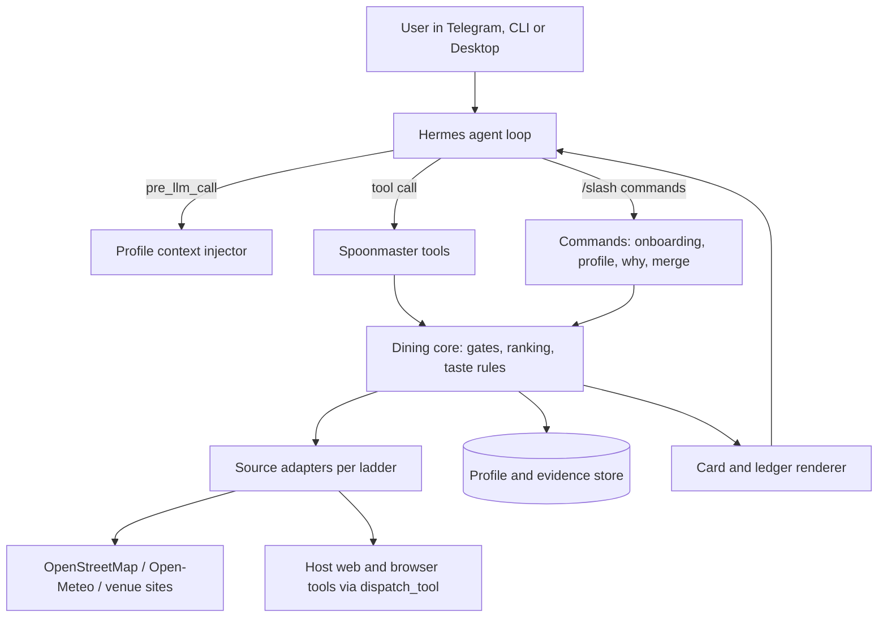

# Spoonmaster architecture

Status: target design, 2026-11-08. Only the evidence-only `spoon_candidates` tool,
bounded OSM adapter and conservative weekly-hours normalization exist. Ranking,
arrival gates, cards, state and the other surfaces below remain planned.

Evidence labels: **docs** = stated in the Hermes developer guide (read 2026-11-08);
**host** = observed read-only on a Hermes 2026.9.24 install; **unverified** = assumed,
must be tested before the design depends on it.

## 1. Shape



The dining core has no Hermes imports so it can be unit-tested with a mock context and
reused later. Hermes wiring is a thin layer.

## 2. Hermes surfaces used

| Need | Surface | Evidence |
|---|---|---|
| Agent-callable actions | `ctx.register_tool` | docs |
| Taste profile in every turn | `pre_llm_call` hook returns context (10,000-char cap, appended to the user message) | docs |
| Deterministic guards on tool arguments | `pre_tool_call` hook (block/approve) or tool-side validation | docs |
| Onboarding, profile, `/why`, merge | `ctx.register_command`; works in CLI and gateway, Telegram bot menu | docs |
| Buttons for pairwise picks | `ctx.ask_choice` from sync slash-command handlers; Telegram shows a button card | docs; behavior unverified |
| Who is asking | Command handlers receive `source.user_id`; profile-scoped state | docs |
| Typed model calls (taste extraction, image reading) | `ctx.llm.complete_structured`, accepts image input, uses the user's active model | docs |
| Durable state | `ctx.state` (profile-scoped, atomic, 10 MiB) or `plugin_db` SQLite under `<HERMES_HOME>/plugin-data/` | docs |
| Borrow the host's web/browser tools | `ctx.dispatch_tool` (goes through normal approvals) | docs; tool names unverified |
| Live progress to attached clients | `ctx.emit_to_session` events | docs; Telegram rendering unverified |
| Settings | `config_schema` in `plugin.yaml`, `ctx.get_config` | docs |
| Optional API keys | `requires_env` plus `agent.secret_scope.get_secret` | docs |
| Bundled guidance | `ctx.register_skill` | docs |
| Agent-to-agent merge | bundled `a2a` plugin (`a2a_discover`, `a2a_call`) | host: present, disabled; untested |
| Images from user | host `vision` toolset enabled | host |
| Voice input | host `stt` toolset disabled on the test host | host |

## 3. Tools and commands (names provisional)

| Tool / command | Purpose |
|---|---|
| `spoon_candidates` (implemented pilot) | Explicit origin and radius; returns distance-sorted OSM evidence only, with unknowns and no recommendation verdict |
| `spoon_recommend` | Origin, radius, ask, household; returns pick/runner-up/wildcard cards and a ledger id |
| `spoon_ledger` / `/why` | Full reject ledger for the last recommendation |
| `spoon_feedback` | Records feedback; returns the taste diff |
| `spoon_profile` / `/spoon profile` | View, correct, remove, delete, export |
| `/spoon start` | Onboarding with pairwise picks |
| `spoon_locale` | Run or refresh the locale scout; show and confirm the ladder |
| `spoon_order_card` | Top dishes and local-language order text for a venue |
| `spoon_merge` / `/spoon merge` | Combine profiles for one decision |

## 4. Request pipeline

```text
recommend(origin, radius, ask, household):
  origin  = resolve(origin)                      # confirm if ambiguous
  ladder  = locale.ladder_for(origin)            # cached; scout if unknown
  cands   = discover(origin, radius, ladder)     # OSM baseline + ladder sources
  for c in cands:                                # parallel, bounded, cached
      c.evidence = gather(c, ladder)
      c.verdicts = [gate(c) for gate in GATES]   # pass | fail | unknown + reason
  keep    = [c for c in cands if no hard fail]
  ranked  = rank(keep, profile, household, ask)  # taste fit + situation
  slots   = pick_runner_up_wildcard(ranked)      # empty slot stays empty
  return render_cards(slots), save_ledger(cands)
```

Gates and ranking are code. The model interprets the ask, writes the one-sentence
tradeoff and phrases the cards from the evidence record.

## 5. Data model (sketch)

```text
Profile
  members[]: id, label, age?, diet[], hard_vetoes[], prefs[], places_loved[], places_avoided[]
  prefs[]: item, kind(dish|attribute|cuisine|venue|vibe), polarity, scope(durable|situational|tentative),
           confidence, provenance(feedback id | onboarding | explicit), context(season, time, occasion)
  rules[]: text, type(hard|soft), applies_to
  home_currency, default_radius, default_mode

Evidence
  venue_id, name, coords, source, url, retrieved_at, supports[], rating{value, scale, count}?,
  hours{raw, parsed, confidence}, menu[]?, price{per_person, currency, basis}?, notes

LedgerEntry
  request_id, venue_id, verdicts[{gate, result(pass|fail|unknown), reason, evidence_ref}]

TasteDiff
  feedback_id, added[], changed[{before, after}], held_situational[], rejected_inferences[]
```

## 6. Sources and adapters

See [source-ladders.md](source-ladders.md). Each adapter declares: access route, key
need, free status, rate limit, cache time, attribution, terms status, and enabled-by-default.

## 7. Credentials, network and disclosure

- Baseline needs no keys. Optional keys are declared in `requires_env` and read only with
  `get_secret`, which returns the active profile's value. The plugin never reads `.env`,
  `auth.json`, browser profiles or keychains.
- Every outbound host is listed in the README and catalog PR disclosure.
- No telemetry.

## 8. Catalog compliance checklist

- `plugin.yaml` plus `__init__.py`; `provides_tools` and `provides_hooks` match
  registrations; `capabilities` declared only if used.
- `requires_hermes` is `>=0.21.5`, matching the package version declared by
  `v2026.9.24`; T3 verified the installed runtime, not a pristine minimum-version matrix.
- Dependencies: bounded ranges within Hermes core constraints; prefer stdlib.
- No self-update, no binaries or bytecode, no core overrides, no private core imports.
- Anything that waits for a person fails cleanly under cron and the gateway.
- `hermes plugins validate . --install-deps` and `hermes plugins doctor . --ci` green.
- Catalog entry: one file `plugin-catalog/spoonmaster.yaml` in `NousResearch/hermes-agent`,
  pinned to a full 40-character SHA, with disclosures and screenshots.

## 9. Testing

1. **Unit:** dining core and Hermes wiring against a mock `ctx` on the development
   machine; synthetic profiles and recorded public fixtures.
2. **Integration:** a throwaway Hermes profile on an existing Hermes host, created by a
   repo script with `hermes profile create`, plugin files copied in (no clone on the
   host), `doctor`, `validate` and scripted CLI sessions, then `hermes profile delete`
   and removal of every copied file, verified by listing.
3. **Channel checks:** Telegram-only behavior verified once near the end, or replaced by
   the portable fallback.

The current scaffold passed doctor, validate (including the install scanner) and
20 model-free tests on installed revision `2bd378ed1b8d6bf2192cb26e0a55ff3091e6bd19`,
Python 3.14.9. That source tree has local modifications, so this is evidence for
the installed host, not a pristine upstream release. `scripts/check-hermes.py`
provides the isolated lifecycle; cleanup was verified on both failure and success.

Security checks for this slice cover finite/range-checked inputs, fixed-host TLS
requests, disabled redirects, bounded responses, safe error codes, HTTP-response
closure, concurrency/cooldown, and no plugin storage or credential reads. The host's
install scan reported safe. This is not evidence that future model-facing prompt
injection defenses, sharing authorization, profile deletion or arbitrary website
fetches are safe; those features do not exist yet. No payments, uploads, public
ingress, admin routes, browser client or CORS surface was added.

## 10. Unverified items that can change the design

| Item | If false |
|---|---|
| Plugins can send images into Telegram | Pairwise onboarding uses text pairs with image links |
| Telegram renders expandable quotes from Hermes | Ledger uses the one-line summary plus `/why` |
| `ask_choice` buttons work in our flow | Numbered replies |
| `a2a` works between two private installs | Shareable profile card |
| Host web tools callable by name through `dispatch_tool` | Plugin uses only its own keyless HTTP adapters |
| Free tiers exist for Google Places and HotPepper | Those adapters are excluded |
