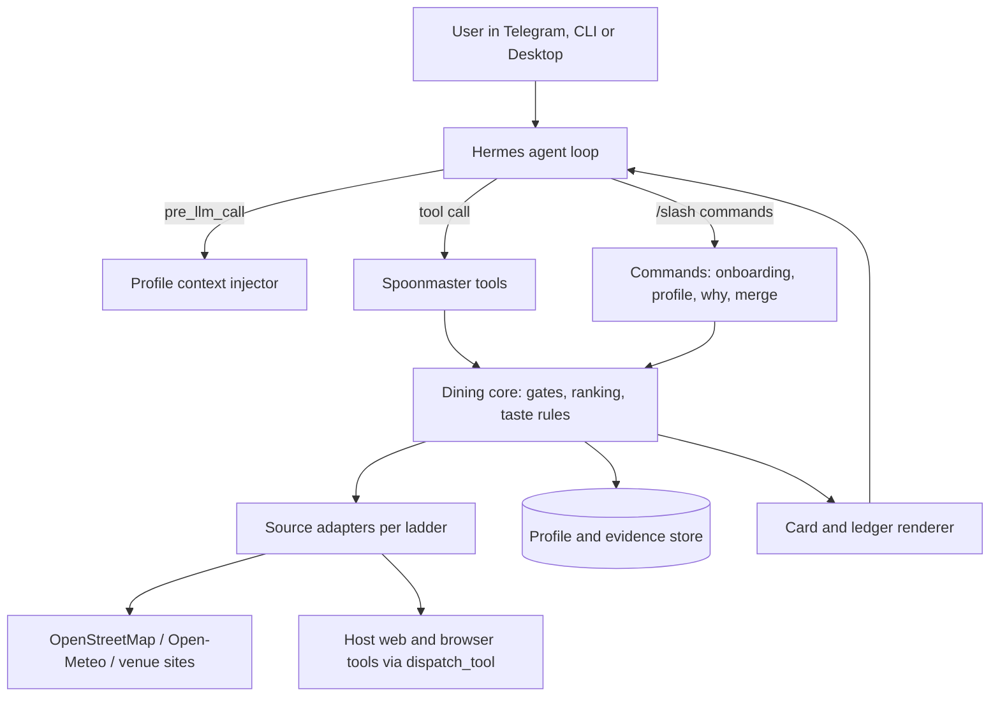

# Spoonmaster architecture

Status: target design, 2026-11-08. Discovery, progressive verification, all ten gate
outcomes, provisional cards and a conversation-scoped reject ledger exist. Weekly arrival math is separate
from unverified date-specific availability. Opt-in taste persistence and evidence-based preference ranking are implemented;
optional onboarding and confirmed dining companions are implemented. Other surfaces below remain planned.

Evidence labels: **docs** = stated in the Hermes developer guide (read 2026-11-08);
**host** = observed read-only on a Hermes 2026.9.24 install; **unverified** = assumed,
must be tested before the design depends on it.

## 1. Shape



The dining core has no Hermes imports so it can be unit-tested with a mock context and
reused later. Hermes wiring is a thin layer.

## 2. Hermes surfaces used

| Need | Surface | Evidence |
|---|---|---|
| Agent-callable actions | `ctx.register_tool` | docs |
| Taste profile in every turn | `pre_llm_call` hook returns context (10,000-char cap, appended to the user message) | docs |
| Deterministic guards on tool arguments | `pre_tool_call` hook (block/approve) or tool-side validation | docs |
| Onboarding, profile, `/why`, merge | `ctx.register_command`; works in CLI and gateway, Telegram bot menu | docs |
| Buttons for pairwise picks | `ctx.ask_choice` from sync slash-command handlers; Telegram shows a button card | docs; behavior unverified |
| Who is asking | Command handlers receive `source.user_id`; profile-scoped state | docs |
| Typed model calls (taste extraction, image reading) | `ctx.llm.complete_structured`, accepts image input, uses the user's active model | docs |
| Durable state | `ctx.state` (profile-scoped, atomic, 10 MiB) or `plugin_db` SQLite under `<HERMES_HOME>/plugin-data/` | docs |
| Borrow the host's web/browser tools | `ctx.dispatch_tool` (goes through normal approvals) | docs; tool names unverified |
| Live progress to attached clients | `ctx.emit_to_session` events | docs; Telegram rendering unverified |
| Settings | `config_schema` in `plugin.yaml`, `ctx.get_config` | docs |
| Optional API keys | `requires_env` plus `agent.secret_scope.get_secret` | docs |
| Bundled guidance | `ctx.register_skill` | docs |
| Agent-to-agent merge | bundled `a2a` plugin (`a2a_discover`, `a2a_call`) | host: present, disabled; untested |
| Images from user | host `vision` toolset enabled | host |
| Voice input | host `stt` toolset disabled on the test host | host |

## 3. Tools and commands (names provisional)

| Tool / command | Purpose |
|---|---|
| `spoon_candidates` (implemented pilot) | Explicit origin and radius; returns distance-sorted OSM evidence only, with unknowns and no recommendation verdict |
| `spoon_verify_hours` (implemented pilot) | Check up to three discovered finalists; refresh the selected venue when unresolved/stale; return sourced hours evidence and call guidance |
| `spoon_recommend` (implemented pilot) | Latest search and explicit outing constraints; verifies and renders provisional pick/runner-up/wildcard cards |
| `spoon_select` (implemented pilot) | Selected displayed venue; refreshes hours and renders uncertainty/call guidance |
| `spoon_evaluate` (implemented pilot) | Evaluate every returned discovery candidate; keep failed and unresolved checks distinct |
| `spoon_ledger` / `/why` (implemented pilot) | Full paginated gate details or a readable exclusion/unknown list for this conversation's latest evaluation |
| `spoon_feedback` (implemented pilot) | Saves bounded user-reported tastes with revision check; returns exact diff |
| `spoon_profile` / `/spoon` (implemented pilot) | View/export plus direct enable, pause, confirm, correct, remove and delete commands |
| `/spoon start` / `/spoon now` (implemented pilot) | Optional six-choice onboarding or immediate food search |
| `spoon_locale` | Run or refresh the locale scout; show and confirm the ladder |
| `spoon_order_card` | Top dishes and local-language order text for a venue |
| `spoon_merge` / `/spoon merge` | Combine profiles for one decision |

## 4. Request pipeline

```text
recommend(origin, radius, ask, household):
  origin  = resolve(origin)                      # confirm if ambiguous
  ladder  = locale.ladder_for(origin)            # cached; scout if unknown
  cands   = discover(origin, radius, ladder)     # OSM baseline + ladder sources
  for c in cands:                                # parallel, bounded, cached
      c.evidence = gather(c, ladder)
      c.verdicts = [gate(c) for gate in GATES]   # pass | fail | unknown + reason
  keep    = [c for c in cands if no hard fail]
  ranked  = rank(keep, profile, household, ask)  # taste fit + situation
  slots   = pick_runner_up_wildcard(ranked)      # empty slot stays empty
  return render_cards(slots), save_ledger(cands)
```

Gates, baseline ranking and card rendering are code. The model interprets the ask
and relays the generated tradeoff, cards and uncertainty without dropping fields.

The current pilot uses `spoon_candidates` → `spoon_recommend` → `spoon_select`.
The recommendation tool evaluates all returned candidates, verifies up to three
finalists, reapplies gates and renders cards. Selection refreshes unresolved or stale
hours. `spoon_evaluate` remains available for inspection without recommendations.
Verification accepts only IDs discovered in this process, never caller-supplied
URLs, schedules or freshness timestamps. Exact source/status,
cache and transport semantics live in the [source ladder](source-ladders.md).

### Gate and ledger core (T4)

The gate engine evaluates every returned candidate against all ten F4 gates. Explicit
failures are `excluded`; candidates with any unknown check are `unresolved`; only all
passes are `eligible`. None of these labels means a recommendation has been selected.
Counts distinguish returned/evaluated candidates from other discovered venues omitted
by the result limit. Radius is recomputed for the original search, never reused from
another origin. A bounding-box center cannot establish an exact entrance distance.

Arrival math uses an explicitly supplied offset-aware arrival and IANA venue time zone,
including the preceding day's overnight service and exclusive closing boundaries.
The weekly schedule result is separate from actual availability, which remains unknown
without date-specific evidence. Missing route, last-order, dietary, household, taste or
friction evidence remains unknown. An explicit venue veto fails; an empty dietary list
means the user explicitly reported no dietary restrictions, not an inferred absence.
T6/T8 and later source adapters provide currently missing inputs without changing this
three-state contract.

Search snapshots and ledgers are process-local, owned by each plugin registration,
and keyed only by host-injected conversation ID. Separate registration scopes do not
share private stores even if conversation IDs repeat. Missing identity fails closed;
IDs in tool arguments cannot choose a
different conversation. Each conversation keeps only its latest search, capped at 100
conversations and expiring 30 minutes after discovery; reads do not extend retention.
A new search invalidates the previous ledger and late evaluations cannot overwrite it.
The complete ledger supports bounded pages without losing entries or evidence links.
`/why` shows three venues per page; `spoon_ledger` exposes one complete entry per page
to bound source-heavy tool output. Both retain evaluation time. Session reset/finalize
hooks clear the supplied conversation ID; expired records are removed on store access.
No state is written to disk. Re-evaluation reads only verification snapshots matching
the venue identity/version in that search, without fetching or changing source times.
The installed revision's [command dispatch contract](https://github.com/NousResearch/hermes-agent/blob/2bd378ed1b8d6bf2192cb26e0a55ff3091e6bd19/hermes_cli/plugin_command_dispatch.py)
supplies `session_id` as host context; the plugin does not accept it in tool arguments.

## 5. Data model (sketch)

```text
Profile
  members[]: id, label, age?, diet[], hard_vetoes[], prefs[], places_loved[], places_avoided[]
  prefs[]: item, kind(dish|attribute|cuisine|venue|vibe), polarity, scope(durable|situational|tentative),
           confidence, provenance(feedback id | onboarding | explicit), context(season, time, occasion)
  rules[]: text, type(hard|soft), applies_to
  home_currency, default_radius, default_mode

Evidence
  venue_id, name, coords, source, url, retrieved_at, supports[], rating{value, scale, count}?,
  hours{raw, parsed, confidence}, menu[]?, price{per_person, currency, basis}?, notes

LedgerEntry
  request_id, venue_id, verdicts[{gate, result(pass|fail|unknown), reason, evidence_ref}]

TasteDiff
  feedback_id, added[], changed[{before, after}], held_situational[], rejected_inferences[]
```

## 6. Sources and adapters

See [source-ladders.md](source-ladders.md). Each adapter declares: access route, key
need, free status, rate limit, cache time, attribution, terms status, and enabled-by-default.

## 7. Credentials, network and disclosure

- Baseline needs no keys. Optional keys are declared in `requires_env` and read only with
  `get_secret`, which returns the active profile's value. The plugin never reads `.env`,
  `auth.json`, browser profiles or keychains.
- Every outbound host is listed in the README and catalog PR disclosure.
- No telemetry.

## 8. Catalog compliance checklist

- `plugin.yaml` plus `__init__.py`; `provides_tools` and `provides_hooks` match
  registrations; `capabilities` declared only if used.
- `requires_hermes` is `>=0.21.5`, matching the package version declared by
  `v2026.9.24`; T3 verified the installed runtime, not a pristine minimum-version matrix.
- Dependencies: bounded ranges within Hermes core constraints; prefer stdlib.
- No self-update, no binaries or bytecode, no core overrides, no private core imports.
- Anything that waits for a person fails cleanly under cron and the gateway.
- `hermes plugins validate . --install-deps` and `hermes plugins doctor . --ci` green.
- Catalog entry: one file `plugin-catalog/spoonmaster.yaml` in `NousResearch/hermes-agent`,
  pinned to a full 40-character SHA, with disclosures and screenshots.

## 9. Testing

1. **Unit:** dining core and Hermes wiring against a mock `ctx` on the development
   machine; synthetic profiles and recorded public fixtures.
2. **Integration:** a throwaway Hermes profile on an existing Hermes host, created by a
   repo script with `hermes profile create`, plugin files copied in (no clone on the
   host), `doctor`, `validate` and scripted CLI sessions, then `hermes profile delete`
   and removal of every copied file, verified by listing.
3. **Channel checks:** Telegram-only behavior verified once near the end, or replaced by
   the portable fallback.

The current scaffold passed doctor, validate (including the install scanner) and
124 model-free tests on installed revision `2bd378ed1b8d6bf2192cb26e0a55ff3091e6bd19`,
Python 3.14.9. That source tree has local modifications, so this is evidence for
the installed host, not a pristine upstream release. `scripts/check-hermes.py`
provides the isolated lifecycle; cleanup was verified on both failure and success.

Security checks for this slice cover finite/range-checked inputs, fixed-host TLS
requests, disabled redirects, bounded responses, safe error codes, HTTP-response
closure, concurrency/cooldown, and no persistent plugin storage or credential reads. The host's
install scan reported safe. This is not evidence that future model-facing prompt
injection defenses, sharing authorization or profile deletion are safe; those features
do not exist yet. The T1 website boundary additionally tests all-answer public DNS
validation, pinned-IP TLS, no redirects, robots denial, response caps, charset handling,
safe phone rendering and unknown/conflicting/stale evidence behavior. No payments, uploads, public
ingress, admin routes, browser client or CORS surface was added.

T4 adds checks for conversation-ID injection, reused IDs across registration scopes,
expiry without read-based extension, cross-conversation access, new-search races,
source-version matching and bounded complete output. Its synthetic cross-registration
test failed before private stores were bound per registration and passes afterward.
The threat considered is access to another conversation's search/arrival context;
the tool cannot accept identity or gate verdicts supplied as model arguments. This
does not establish durable-profile sharing safety or end-to-end Telegram delivery.

## 10. Unverified items that can change the design

| Item | If false |
|---|---|
| Plugins can send images into Telegram | Pairwise onboarding uses text pairs with image links |
| Telegram renders expandable quotes from Hermes | Ledger uses the one-line summary plus `/why` |
| `ask_choice` buttons work in our flow | Numbered replies |
| `a2a` works between two private installs | Shareable profile card |
| Host web tools callable by name through `dispatch_tool` | Plugin uses only its own keyless HTTP adapters |
| Free tiers exist for Google Places and HotPepper | Those adapters are excluded |

### T5 recommendation cards

`cards.py` renders every required field or an explicit unknown. `shortlist.py` uses
exact distance for the initial baseline, excludes failed gates, requires confirmed
origin and fresh mapped points, and does not select weekly-predicted closures.
Nearby matching names are deduplicated; a veto applies to duplicate representations.
A wildcard requires a different listed cuisine. Missing slots remain empty. T6 adds supported cuisine/venue preference matches before distance ordering. `spoon_recommend` verifies at most three proposed finalists before rendering any
cards, then reapplies gates without replacing newly excluded slots with unchecked
venues. `spoon_select` permits only the latest displayed IDs and refreshes evidence
under D-013. D-014 permits provisional picks without upgrading unknown gates.

Private records carry a revision counter: a network result can save only if its
search and revision still match. New recommendation requests clear prior choices
before verification, including cooldown/error paths. Re-evaluation also clears
choices. Selection retains original outing age; hours refresh never extends consent.
No raw dietary list is retained in the ledger. All private state stays registration/conversation
scoped and uses the existing expiry/reset/finalize behavior.

T5 review covers strict arguments, ID swaps, registration isolation, rendered source
text, bounded public-page reads, cooldown failures and concurrent state changes.
No new dependencies, credentials, paid APIs, ingress, uploads or payment surfaces.
Telegram rendering and a broad release security review remain tracker work.

### T6 storage core

`taste.py` stores bounded structured preferences in a versioned SQLite file beneath
the plugin data directory. Reads before opt-in create nothing. Transactions pair
revision checks, mutation and the returned diff; a failed batch rolls back entirely.
Tentative, situational and durable items retain provenance and confidence. Model
feedback cannot promote an item to durable or overwrite a directly confirmed item.
User controls confirm/correct/remove items, pause learning or delete their profile.
Deletion uses SQLite secure deletion; Hermes transcripts and external backups are
separate. Raw feedback transcripts and exact location history are not stored.
`TasteService` resolves identity from human command context or the documented
`gateway.session_context` API, never model arguments. Private sender keys include
platform and scope; local CLI is separate. Unidentified or shared contexts cannot
read/write tastes. Reset/finalize clears access bindings and outing context, not saved
tastes. New private sessions reconnect automatically when host context is available.
The fallback is `/spoon profile`. Profiles never merge across channels implicitly.
Cached taste explanations carry an owner scope and profile revision. Changes/deletion
clear those results even after identity-binding eviction, and ledger reads check for
changes made by another process. The underlying venue search remains available.

`pre_llm_call` checks availability once per turn and injects only a short tool-use
notice, not the whole profile. Expected weight: roughly 1-10 ms local SQLite read;
contention may wait up to the bounded 2-second database timeout. No network or model
call runs in the hook. Recommendation tools read current preferences, rank only exact
cuisine/venue matches and expose matching reasons in both cards and the gate ledger.
Tentative tastes have half the weight of confirmed/situational matches. Context tags
must match explicit outing input; no inferred season, company or health claims.

T6 review covers per-person and per-registration access, strict mutation inputs,
parameterized SQL, opt-in, rollback, concurrent revisions, targeted deletion, corrupt
state, source text and supported ranking. Disabling owner separation makes the
isolation test fail. The host-context reconnection test runs only inside the owned
throwaway profile. Broader host-tool permissions, encrypted backups, public-service
abuse controls and end-to-end Telegram delivery are not established by this review.

Host contracts inspected at `2bd378ed1b8d6bf2192cb26e0a55ff3091e6bd19`:
[plugin state facade](https://github.com/NousResearch/hermes-agent/blob/2bd378ed1b8d6bf2192cb26e0a55ff3091e6bd19/hermes_cli/plugins_state.py),
[session context](https://github.com/NousResearch/hermes-agent/blob/2bd378ed1b8d6bf2192cb26e0a55ff3091e6bd19/gateway/session_context.py).

### T7 onboarding core

`onboarding.py` offers personalization or immediate search, with six optional pairs
and numbered text commands. Choice and reminder markers are stored separately from
tastes in an additive `onboarding` table after the user chooses a path. First-offer
reads create no files. Answers stay in bounded, two-hour memory until all six replies
are complete; a single transaction saves tentative likes and the completion marker.
No unchosen option becomes a dislike. Existing tastes are preserved; a concurrent
profile change or deletion rejects a stale completion. Profile deletion also removes
onboarding markers. Interrupted drafts can be restarted; partial tastes are not saved.
The existing `pre_llm_call` hook adds the first-use offer and recognizes direct
onboarding phrases/answers. It does not block the user's food search or infer missing
location. A direct command can call public `ctx.ask_choice`; unsupported channels get
numbered text commands. No extra hook, network call or model call was introduced.
Additional hook weight is normally a few local SQLite reads (roughly 1-10 ms; each
contended transaction has the existing 2-second timeout).

`spoon_select` appends the brief reminder only after a successful selection; errors
and predicted closures do not consume it. An atomic marker claim prevents duplicate
reminders across instances. First-offer memory distinguishes an offer actually shown
from an existing profile merely inspected. Failures while saving the final answer
produce explicit failure context rather than allowing a completion claim.

T7 review/tests cover skip without tastes, first-read privacy, button/text fallback,
stale questions and attempts, changed/deleted profiles, profile-scoped draft cleanup,
atomic seeding rollback and reminder claims, plus the actual registered flow from
skip through selection to later onboarding and a new session. Shared contexts remain
denied. The host-only test exercises markers and completion through the real Hermes
identity/data APIs. Live Telegram buttons and model-rendered offers remain unverified.

### T8 dining companions and household rules

`household.py` validates bounded member inputs and hard/soft outing rules. Discovery
retains only exact supported OSM age, diet and highchair tags; code evaluates conflicts
without interpreting source prose. Rule IDs identify anonymous members and rule positions.
Fresh hard conflicts exclude a venue. Unknowns remain provisional with explicit card
warnings, as approved; positive tags cannot establish dietary safety or live availability.
Companion cuisine preferences contribute only soft ranking and cannot bypass gates.

`companions.py` reuses the private SQLite transaction boundary, with an additive
owner/label-keyed table and random revisions. Model tools can view records and prepare
previews, but only direct human commands can save or activate them. Nonempty dietary
fields require the sensitive-save variant. Replacements compare revisions and return
exact before/after values. Deletion also works on corrupt payloads. Whole-profile
deletion removes companion rows in the same transaction as tastes and onboarding.

Groups can represent family, coworkers or friends. The existing context hook exposes
only available labels and asks the agent to confirm attendance when a group is referenced.
Per-search activation uses a member subset and optional rule subset, with the full
effective party previewed before human confirmation. Nothing activates merely by
mentioning a label, viewing a profile or starting a new session. These are the owner's
private records, not imported profiles or implied consent from another agent (T10).

Previews/active parties are registration/session/owner/profile scoped and bounded to
15 minutes and 100 conversations. Activation invalidates previous cards; a new search
does not inherit it. Wrapped evaluate/recommend/select/ledger commands validate the
saved revision before and after execution. Changes/deletion/expiry clear affected
outings, including changes made by another process. No raw ages/diets enter the ledger.
The pre_llm_call addition performs bounded local reads only, typically milliseconds
with the existing 2-second SQLite contention timeout; no extra hook/network/model call.
Live model recognition and Telegram confirmation delivery remain unverified.
